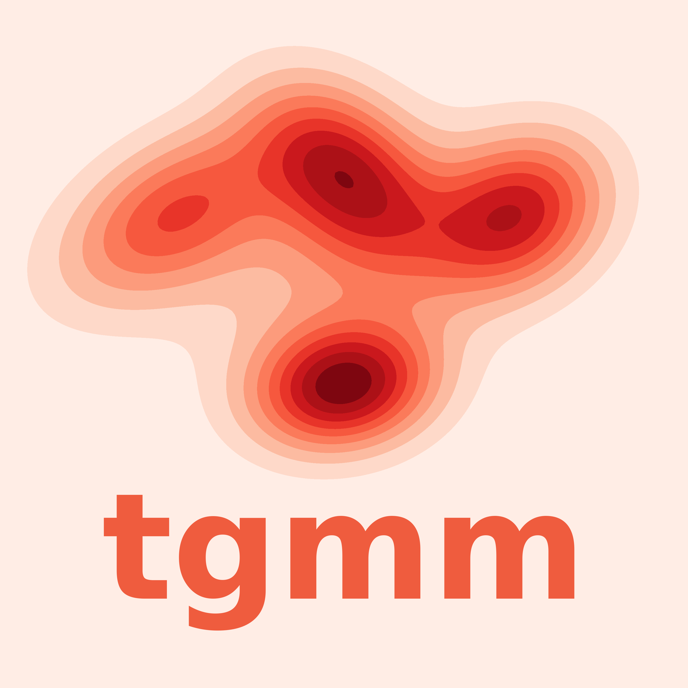

<div align="center" markdown="1">



</div>

# tgmm: Gaussian Mixture Models in PyTorch

**tgmm** is a flexible, GPU-accelerated implementation of Gaussian Mixture Models (GMM) in PyTorch.
It supports EM, MAP and Gibbs-sampling (Dirichlet-process) estimation, 14 covariance structures,
several EM variants, fixed values and bounds on the parameters, semi-supervised and
positive-unlabeled learning, a uniform noise component, missing-value EM, marginal/conditional
distributions, several initialisation strategies (k-means, k-means++, ...), model selection,
and a comprehensive suite of clustering metrics and visualization tools.

A mixture model writes the density of the data as a weighted sum of components,

$$
p(x)=\sum_{k=1}^{K}\pi_k\,f_k(x\mid\theta_k),\qquad \sum_k\pi_k=1,
$$

and EM alternates computing each component's responsibility for each point (E-step) with
re-estimating the parameters from those soft assignments (M-step). The
[Introduction tutorial](notebooks/01_introduction.ipynb) derives every update tgmm implements.

## Installation

=== "PyPI (Stable)"

    ```bash
    pip install tgmm
    ```

=== "Development (Latest)"

    ```bash
    git clone https://github.com/adriansousapoza/tgmm.git
    cd tgmm
    pip install -e .
    ```

**Requirements**: Python 3.9+ and PyTorch 2.5+ (see [Installation](getting-started/installation.md))

For GPU support, install CUDA-enabled PyTorch following the [official instructions](https://pytorch.org/get-started/locally/).

## Documentation Structure

- **[Getting Started](getting-started/installation.md)** - Installation and quick start guide
- **Check out the [Tutorials](tutorials/index.md) to see tgmm in action!** - marimo notebooks, rendered here and runnable on molab
- **[API Reference](api/gaussian-mixture.md)** - Complete API documentation

## Quick Start

```python
import torch
import numpy as np
from tgmm import GaussianMixture

# Generate sample data
np.random.seed(42)
X = np.vstack([
    np.random.multivariate_normal([0, 0], [[1, 0.5], [0.5, 1]], 300),
    np.random.multivariate_normal([3, 3], [[1, -0.3], [-0.3, 1]], 300),
    np.random.multivariate_normal([-2, 2], [[0.5, 0], [0, 2]], 200)
])
X_tensor = torch.tensor(X, dtype=torch.float32)

# Create and fit GMM
gmm = GaussianMixture(n_components=3, random_state=42)
gmm.fit(X_tensor)

# Make predictions
labels = gmm.predict(X_tensor)
print(f"Converged: {gmm.converged_}, Iterations: {gmm.n_iter_}")
```

See the [Tutorials](tutorials/index.md) for runnable, end-to-end examples of every feature --
covariance structures, initialization strategies, MAP estimation with priors, EM variants,
model selection, semi-supervised fitting, constrained sampling, save/load, and more.

## Key Features

### 1. Gaussian Mixture Model

The core `GaussianMixture` class supports:

- **Covariance structures**: the six classic types (`'full'`, `'diag'`, `'spherical'`, `'tied_full'`,
  `'tied_diag'`, `'tied_spherical'`) and all 14 Celeux & Govaert (1995) GPCM models via their mclust
  codes (`'EII'`, `'VEI'`, `'EVE'`, `'VVV'`, ...), which decompose each covariance into volume, shape and
  orientation -- see [Covariance Types](notebooks/02_covariance_types.ipynb)
- **Estimation**: MLE, or MAP with Dirichlet / Gaussian / Inverse-Wishart / Normal-Inverse-Wishart priors
- **Algorithms**: `algorithm='em'`, `'cem'` (Classification EM), `'sem'` (Stochastic EM) or `'saem'`
  (Stochastic Approximation EM); `temperature` adds deterministic annealing; `batch_size` / `step_size` give
  memory-bounded, mini-batch and online EM (plus `partial_fit` for streams); `convergence='aitken'`
  adds an accelerated stopping rule
- **Dirichlet-process mixtures**: `GaussianMixture(n_components=None, ...)` runs a collapsed Gibbs
  sampler that infers the number of components
- **Initialization**: multiple strategies via `GMMInitializer`
- **Model selection**: `bic` / `aic` / `icl` methods, and `select_model` to sweep `n_components` and all 14
  covariance codes at once ([Model Selection tutorial](notebooks/13_model_selection.ipynb))

### 2. Semi-supervised and positive-unlabeled learning

`GaussianMixture` supports `fit(X, labels=...)` with `-1` for unknown rows (semi-supervised EM, multiple components
per class), and `PositiveUnlabeledMixture` handles positive-unlabeled (PU) learning under the SCAR assumption.
See [Semi-Supervised and PU Fitting](notebooks/15_semi_supervised_pu.ipynb).

### 3. Noise, missing values and conditioning

`noise=True` adds a uniform noise component that labels strays `-1`; `missing='em'` fits data with `NaN` entries and
`impute`s them; `GaussianMixture.marginal` / `condition` give marginal and conditional distributions (Gaussian mixture
regression); `frozen_components` and `sample_weight` control what EM may change; and `GenericMixture` fits components you write
yourself. See [Noise, Missing Values and Conditioning](notebooks/16_noise_missing_conditioning.ipynb).

### 4. Clustering metrics

`ClusteringMetrics` provides unsupervised indices (Silhouette, Davies-Bouldin, Calinski-Harabasz, Dunn,
WB-Index, Wemmert-Gancarski, DBCV) and supervised metrics (ARI, NMI/AMI, purity, homogeneity,
completeness, V-measure, confusion matrix and classification report). See
[Metrics and Evaluation](notebooks/09_metrics.ipynb).

### 5. Density-based clustering

`HDBSCAN` is a PyTorch implementation of hierarchical density-based clustering -- no `K` needed,
non-convex clusters, explicit noise points (see the [HDBSCAN tutorial](notebooks/12_hdbscan.ipynb)).

### 6. Building blocks

`SufficientStats` (the additive $n_k,\sum_ir_{ik}x_i,W_k$ statistics behind every M-step, used by
chunked, online and streaming fitting) and `BaseMixture` (the EM machinery shared by `GaussianMixture`, `ConditionalGaussianMixture` and `GenericMixture`) are public.

### 7. Visualization

`plot_gmm` draws component ellipses at several confidence levels, cluster / ground-truth / log-likelihood
coloring, initial vs. final means and weight-scaled markers for 2-D data
(`plot_gmm` itself requires 2-D data -- project higher-dimensional data first).

## Citation

TBA

## License

This project is licensed under the MIT License - see the LICENSE file for details.

## Contributing

tgmm isn't yet set up to accept external contributions. If you're interested in contributing,
please reach out to [asp@di.ku.dk](mailto:asp@di.ku.dk).
